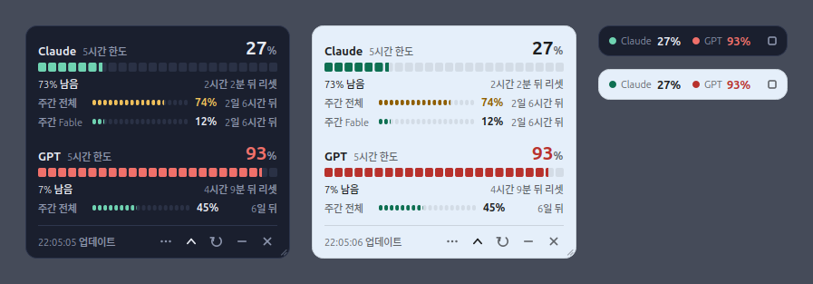

# gpt_claude_usage

Claude와 GPT(Codex)의 **5시간 한도**와 **주간 한도**를 바탕화면 구석에 띄워 두고 보는 작은 위젯입니다.
각 CLI(Claude Code, Codex CLI)가 로그인해 둔 계정에서 사용률을 읽어 오며, 30초마다 새로고칩니다.



<sub>왼쪽부터 기본 색(주간 한도 펼침), 밝은 바탕(하늘), 최소화 막대. 숫자는 예시입니다.</sub>

## 무엇을 보여 주나

- **Claude**: 5시간 한도, 주간 전체 한도, 특정 모델에만 걸리는 주간 한도(기본 Fable)
- **GPT**: 5시간 한도, 주간 한도
- 리셋까지 남은 시간, 남은 비율. 70% 이상이면 노란색, 90% 이상이면 빨간색
- 크기 조정, 최소화, 색상 선택, 투명도, 항상 위, 로그인 시 자동 시작
- 사용량을 **조회만** 하므로 토큰이나 크레딧이 소모되지 않습니다

## 요구 사항

| 항목 | 내용 |
|---|---|
| 운영체제 | Linux. 설치 스크립트는 apt를 쓰는 Ubuntu / Debian 계열용입니다. Ubuntu 24.04 + GNOME에서 확인했습니다. |
| Python | 시스템 Python 3 (`/usr/bin/python3`) + PyQt6. PyQt6는 `setup.sh`가 설치합니다. Python 3.12 + PyQt6 6.6.1 (Qt 6.4.2)에서 확인했습니다. |
| Claude | claude.ai **Pro/Max 구독** + Claude Code 로그인. API 키로 쓰는 계정에는 한도 값이 내려오지 않습니다. |
| GPT | ChatGPT 구독 + Codex CLI에 **ChatGPT 계정으로** 로그인. API 키 로그인에는 한도 값이 없습니다. |

둘 중 한쪽만 로그인돼 있어도 그쪽 값은 정상적으로 나옵니다. 쓰지 않는 쪽은 메뉴에서 숨기면 됩니다.

## 설치

### 1. CLI 설치와 로그인 (처음 한 번)

이미 `claude`, `codex`로 로그인해 쓰고 있다면 건너뛰세요.

**Claude Code**

```bash
curl -fsSL https://claude.ai/install.sh | bash
claude          # 처음 실행하면 브라우저가 열립니다. Pro/Max 계정으로 로그인하세요.
```

**Codex CLI** (sudo 없이 `~/.local/bin`에 설치. x86_64, ARM64 모두 같은 명령)

```bash
mkdir -p ~/.local/bin
curl -fsSL "https://github.com/openai/codex/releases/latest/download/codex-$(uname -m)-unknown-linux-musl.tar.gz" \
  | tar -xz -C ~/.local/bin
mv ~/.local/bin/codex-$(uname -m)-unknown-linux-musl ~/.local/bin/codex
~/.local/bin/codex login      # 브라우저에서 ChatGPT 계정으로 로그인
```

Node.js가 있다면 `npm install -g @openai/codex`로 설치해도 됩니다.
로그인할 때는 **이 컴퓨터의 브라우저**에서 열어야 합니다. 로그인이 끝나면 `localhost`로 돌아와야 완료되기 때문입니다.
로그인 상태는 `codex login status`로 확인할 수 있습니다.

### 2. 위젯 설치

```bash
sudo apt install -y git          # git이 없을 때만
git clone https://github.com/jaemin0319/gpt_claude_usage.git ~/gpt_claude_usage
cd ~/gpt_claude_usage
bash setup.sh
```

`setup.sh`는 아래를 차례로 진행합니다. 물어보는 곳에서 Enter만 누르면 기본값으로 넘어갑니다.

| 단계 | 하는 일 | 기본값 |
|---|---|---|
| 1. PyQt6 | 없으면 `apt install python3-pyqt6` (sudo 비밀번호를 물을 수 있음) | 자동 |
| 2. Claude 연동 | Claude Code의 statusLine에 브리지를 걸어, 계정 조회가 막힐 때 쓸 예비 경로를 만든다. `~/.claude/settings.json`은 `.bak`으로 백업한다 | 설치 |
| 3. 아이콘 | 앱 목록과 바탕화면에 "AI 사용량 위젯" 아이콘 | 자동 |
| 3-1. 자동 시작 | 로그인할 때마다 위젯을 띄운다 | 안 함 |
| 4. 실행 | 위젯을 터미널과 분리해서 띄운다 | 자동 |

바탕화면 아이콘을 처음 누르면 실행을 허용할지 한 번 물을 수 있습니다.

### 3. 확인

```bash
bash check.sh                  # 실제 계정으로 조회 경로 4가지를 각각 시험
python3 tests/selftest.py      # 창을 띄우지 않고 화면 동작 점검 (계정·네트워크 불필요)
```

`check.sh`는 서비스마다 `[O]`가 하나라도 있으면 위젯에 값이 나옵니다.
`selftest.py`는 크기 조정, 최소화, 색상, 설정 복원 등 29가지를 가짜 데이터로 점검하고, 끝에 "모두 통과"를 출력합니다.

## 사용법

| 동작 | 방법 |
|---|---|
| 이동 | 카드를 마우스로 끌기 |
| 크기 조정 | 오른쪽 아래 모서리 끌기. Ctrl + 휠, 또는 오른쪽 클릭 → "크기"로도 바꿀 수 있음 (75%~200%) |
| 주간 한도 펼치기 / 접기 | 아래쪽 화살표 버튼 |
| 최소화 | − 버튼. 5시간 사용률만 남은 작은 막대가 되고, 막대의 □ 버튼으로 다시 펼침 |
| 색상 | 오른쪽 클릭 → "색상" → 견본 12가지 중 고르기, 또는 "직접 고르기…" |
| 지금 새로고침 | 회전 화살표 버튼 |
| Claude / GPT 숨기기 | ⋯ 버튼(또는 오른쪽 클릭) → "Claude 보기" / "GPT 보기" |
| 투명도 / 항상 위 | 오른쪽 클릭 |
| 종료 | × 버튼 (다시 켜려면 앱 목록의 "AI 사용량 위젯") |

- 크기를 바꾸면 글꼴, 미터, 버튼이 함께 커지고 작아집니다. 위젯이 화면 오른쪽에 있으면 크기를 바꾸거나 최소화해도 오른쪽 모서리가 제자리에 있습니다.
- 색상은 카드 바탕색을 고르는 기능입니다. 글자·선·메뉴 색은 바탕에 맞춰 자동으로 정해지고, 밝은 바탕에서는 글자와 경고색이 진해집니다. 견본 12가지는 모두 글자 대비 4.5:1 이상입니다.
- 마우스를 올리면 툴팁에 측정 시각, 정확한 리셋 시각, 실패 이유가 나옵니다.
- 숨긴 서비스는 조회도 하지 않으며, 둘 중 하나는 항상 보입니다.
- 위치, 크기, 색상, 투명도, 펼침/최소화 상태, 보이는 서비스는 `~/.config/AIUsageWidget/Card.conf`에 저장되고 다음 실행 때 복원됩니다.

### 로그인할 때 자동으로 띄우기

`setup.sh`의 자동 시작 질문에 `y`라고 답하면 됩니다. 나중에 켜려면 다음을 실행하세요.

```bash
mkdir -p ~/.config/autostart
{ cat ~/.local/share/applications/ai-usage-widget.desktop
  echo "X-GNOME-Autostart-enabled=true"; echo "X-GNOME-Autostart-Delay=5"; } \
  > ~/.config/autostart/ai-usage-widget.desktop
```

끄려면 `rm ~/.config/autostart/ai-usage-widget.desktop`. × 버튼으로 닫은 위젯은 다음 로그인 때까지 다시 켜지지 않습니다.

## 설정 바꾸기

메뉴에 없는 설정은 `ai_usage_widget.py` 맨 위 `[1] 설정` 구획에서 바꿉니다. 바꾼 뒤에는 위젯을 다시 켜세요.

| 이름 | 기본값 | 뜻 |
|---|---|---|
| `REFRESH_INTERVAL_SEC` | `30` | 자동 새로고침 주기(초) |
| `WARN_PCT` / `CRITICAL_PCT` | `70` / `90` | 노란색 / 빨간색으로 바뀌는 사용률 |
| `CLAUDE_SCOPED_WEEKLY` | `"fable"` | Claude의 모델별 주간 한도 줄에 보일 모델 (`opus`, `sonnet` 등). 계정에 없으면 "값 없음" |
| `CLAUDE_AUTO_REFRESH` | `True` | Claude 로그인 토큰이 만료됐을 때 `claude -p /usage`로 갱신할지 |
| `FALLBACK_MAX_AGE_SEC` | `900` | 예비 경로 값이 이보다 오래됐으면 쓰지 않음(초) |
| `USE_MOCK` | `False` | `True`면 계정 없이 더미 데이터로 화면만 확인 |

## 값을 어디서 가져오나

| 서비스 | 1순위 (지금 값) | 2순위 (마지막 기록) |
|---|---|---|
| Claude | `~/.claude/.credentials.json`의 로그인 토큰으로 `api.anthropic.com`에 사용량 조회 (2분 간격) | statusLine 브리지가 남긴 `~/.claude/statusline-state.json` |
| GPT | `~/.codex/auth.json`의 로그인 토큰으로 `chatgpt.com`에 사용량 조회 | Codex 세션 로그(`~/.codex/sessions`)의 마지막 기록 |

- 1순위가 막히면 2순위로 물러서되, 2순위 값이 15분보다 오래됐으면 쓰지 않고 실패 이유를 보여 줍니다. 옛 값을 지금 값처럼 보이지 않게 하려는 것입니다.
- 토큰은 이 컴퓨터의 로그인 파일에서 읽기만 하고, 위 두 주소 말고는 어디에도 보내지 않습니다.
- Claude 로그인 토큰은 몇 시간이면 만료되고, 원래는 Claude Code를 실행할 때만 갱신됩니다. 위젯은 만료를 보면 `claude -p /usage`를 한 번 실행해 Claude Code가 스스로 갱신하게 합니다. `/usage`는 모델을 부르지 않는 로컬 명령이라 사용량이 들지 않습니다. 30분에 한 번까지만, Claude Code 2.1.278 이상에서만 시도합니다(그보다 낮은 버전에서는 갱신한 토큰을 저장하기 전에 끝나 로그인이 풀릴 수 있다는 보고가 있습니다).
- Codex 토큰은 위젯이 갱신하지 않습니다. GPT 칸에 "로그인 갱신 필요"가 뜨면 터미널에서 `codex`를 한 번 실행하세요.
- 두 조회 주소 모두 **공식 문서에 없는 비공개 엔드포인트**입니다. 응답 형식이 바뀌면 조회가 실패할 수 있고, 그때는 "불러오지 못함"이 표시됩니다.

## 문제 해결

| 증상 | 확인할 것 |
|---|---|
| 숫자 대신 "불러오지 못함" | 그 줄에 마우스를 올려 이유 확인 → `bash check.sh` |
| "로그인 갱신 필요" | Claude는 터미널에서 `claude`, GPT는 `codex`를 한 번 실행 |
| 위젯이 안 보임 | 먼저 `pgrep -af ai_usage_widget.py`로 떠 있는지 확인. 떠 있다면 대개 **다른 작업 공간**에 있거나, "항상 위"가 꺼져 다른 창에 가려진 경우입니다 |
| 실행 직후 꺼짐 | `cat ~/.cache/ai-usage-widget/widget.log` |
| `Could not load the Qt platform plugin "xcb"` | pip로 설치한 PyQt6라면 `sudo apt install -y libxcb-cursor0` |
| `codex: command not found` | `~/.local/bin`이 PATH에 없는 경우. 다시 로그인하거나 `~/.local/bin/codex`로 실행 |

Wayland 세션에서도 위젯은 X11(XWayland)로 뜹니다. Wayland에서는 앱이 스스로 "항상 위"를 걸거나 창 위치를 정할 수 없기 때문입니다. GNOME은 XWayland를 기본으로 켜 둡니다.

## 업데이트

```bash
cd ~/gpt_claude_usage
git pull --ff-only
pkill -f '^[^ ]*python[0-9.]* ([^ ]*/)?ai_usage_widget\.py'; bash run_widget.sh
```

`pkill`은 위 패턴 그대로 쓰세요. 그냥 `pkill -f ai_usage_widget.py`라고 하면, 그 명령을 실행하는 셸(예: AI 도우미의 셸)까지 함께 꺼질 수 있습니다.
git 없이 파일만 받아 쓰는 경우에는 [UPDATE_PROMPT.md](UPDATE_PROMPT.md)를 Claude Code에 붙여넣으면 교체와 재시작을 대신 해 줍니다.

## 제거

```bash
pkill -f '^[^ ]*python[0-9.]* ([^ ]*/)?ai_usage_widget\.py'
cd ~/gpt_claude_usage && bash install_claude_bridge.sh --uninstall     # Claude statusLine 원상복구
rm -f ~/.local/share/applications/ai-usage-widget.desktop \
      ~/.config/autostart/ai-usage-widget.desktop \
      "$(xdg-user-dir DESKTOP 2>/dev/null || echo ~/Desktop)/ai-usage-widget.desktop"
rm -rf ~/.config/AIUsageWidget ~/.cache/ai-usage-widget    # 저장된 설정과 로그
rm -rf ~/gpt_claude_usage
```

## Windows에서

위젯 본체는 Windows에서도 돌도록 짜여 있습니다. 설치 스크립트들은 Linux 전용이라 직접 실행합니다.

```powershell
pip install -r requirements.txt
pythonw ai_usage_widget.py
```

Claude Code와 Codex CLI 로그인 파일은 사용자 폴더의 `.claude`, `.codex` 아래에서 찾습니다. Windows와 macOS는 직접 확인하지 않았습니다.

## 파일 구성

| 파일 | 역할 |
|---|---|
| `ai_usage_widget.py` | 위젯 본체 (단일 파일). 위쪽 `[1]`~`[7]` 구획이 설정, 데이터 모델, Claude/GPT 조회, 워커, UI, 진입점 |
| `setup.sh` | 설치 전부 (PyQt6, 브리지, 아이콘, 자동 시작, 실행) |
| `run_widget.sh` | 실행만. 이미 떠 있으면 하나 더 띄우지 않고, 로그를 `~/.cache/ai-usage-widget/`에 남김 |
| `check.sh` | 실제 계정으로 조회 경로 점검 |
| `tests/selftest.py` | 창 없이 화면 동작 점검. `--shots docs/screenshot.png`로 위 스크린샷을 다시 만듦 |
| `claude_usage_bridge.py` | Claude Code statusLine 브리지 (한도 값을 파일로 남김) |
| `install_claude_bridge.sh` | 브리지 설치 / 제거 (`--uninstall`) |
| `requirements.txt` | pip로 설치할 때의 의존성 (PyQt6) |
| `icon.png` | 아이콘 |
| `SETUP_PROMPT.md` | 설치를 도와줄 AI에게 붙여넣을 프롬프트 (터미널이 낯선 사람에게 보낼 때) |
| `UPDATE_PROMPT.md` | git 없이 받은 새 파일로 교체할 때 Claude Code에 붙여넣을 프롬프트 |
